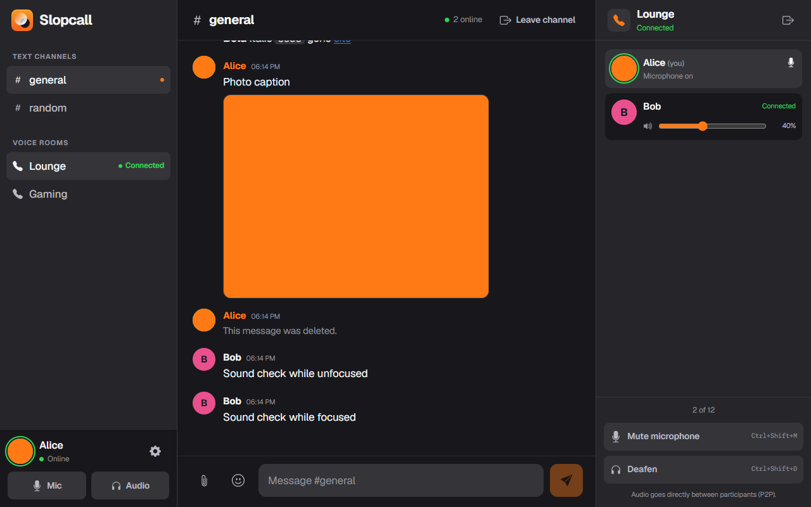

# Slopcall

Mini Discord x TeamSpeak: text channels plus peer-to-peer group voice, with a Windows tray client.

- **Server:** Node.js + `ws`, no database and no native modules. Messages are appended to JSONL files; uploaded files are stored as UUID blobs with metadata sidecars.
- **Client:** Tauri 2 + Svelte 5. One small `.exe`/installer, WebView2 runtime, Windows tray icon.
- **Voice:** WebRTC full mesh (P2P). The server only relays signaling, so it stays tiny enough for 1 vCPU / 2 GB.
- **Limits:** 32 users online, 12 people per voice room, 50 messages of history per channel, 256 MB per uploaded file.

## Repository layout

```
server/                 Realtime server (Node.js)
  src/index.js          HTTP health/upload endpoints + WebSocket protocol
  src/store.js          Append-only JSONL message store
  src/uploads.js        Uploaded-file storage, retention, and cleanup
  src/config.js         Channels, rooms, limits, ICE servers
  test/                 Protocol tests
client/                 Windows desktop client
  src/                  Svelte UI
  src-tauri/            Tauri shell (tray, hotkeys, single instance)
  scripts/smoke.mjs     Two-client end-to-end smoke test
DEPLOY.md               Server deployment steps
```

## Local development

Requirements: Node.js 20+ (24 recommended), and for the desktop shell Rust + MSVC build tools.

```powershell
# terminal 1 - server
cd server
npm install
npm start                 # http://127.0.0.1:8787

# terminal 2 - client
cd client
npm install
npm run dev               # http://127.0.0.1:1420
```

To run the real desktop shell instead of the browser:

```powershell
cd client
npm run tauri dev
```

The default server address is `ws://127.0.0.1:8787`. It can be changed in the app under
**Settings → Server**, or baked in at build time with `VITE_SERVER_URL`.

## Tests

```powershell
cd server
npm test                  # protocol, persistence, rate limiting, health

cd client
npm run check             # TypeScript + Svelte diagnostics
npm run test:e2e          # two clients: text, voice, media, profiles, and message actions
```

The e2e test expects the server on `ws://127.0.0.1:8787` and the dev server on
`http://127.0.0.1:1420`, and uses the installed Microsoft Edge as the browser engine.

## Build the Windows installer

```powershell
cd client
npm run tauri build
```

The NSIS installer is written to
`client/src-tauri/target/release/bundle/nsis/`. It installs per-user, so no admin rights
are required.

## Features in the MVP

- Nickname onboarding, custom profile pictures, language from the Windows locale (English / Russian, changeable in Settings).
- Fixed text channels `#general` and `#random`; persistent 50-message history.
- Safe inline Markdown (bold, italic, strikethrough, code, links), bundled Contestmoji, and native Unicode emoji.
- File attachments up to 256 MB with image previews and automatic 7/30-day retention.
- Typing indicators, reactions, and author-only edit/delete.
- Voice rooms `Lounge` and `Gaming`; a 1:1 call is simply a two-person room.
- Mute microphone and deafen with global hotkeys `Ctrl+Shift+M` / `Ctrl+Shift+D`.
- Per-user playback volume sliders.
- Join and leave text channels or voice rooms without reloading the app.
- Closing the window hides it to the tray; the tray menu has Open, Mute, Deafen, Quit.

## Screenshots



[Russian onboarding](docs/screenshots/onboarding-ru.png)

Deployment instructions for the Ubuntu server are in [DEPLOY.md](DEPLOY.md).
